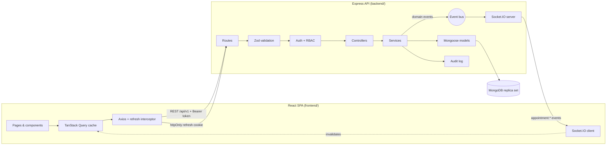
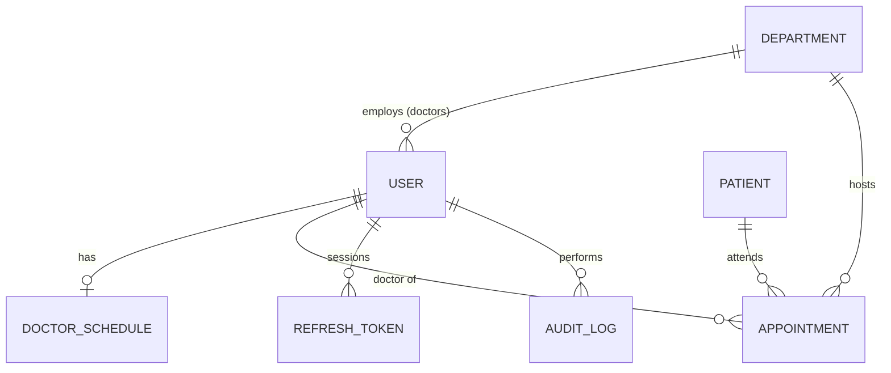

# EMR Appointment Management System

The appointment management module of an Enterprise Electronic Medical Record (EMR) system,
built on the MERN stack (MongoDB, Express, React, Node.js).

Front-desk staff book patients into doctors' time slots, admins configure each doctor's
working hours, and doctors see their own day. Every change is pushed live to everyone viewing
the same schedule.

> **Status:** backend and frontend are complete. The backend has an automated test suite; the
> frontend was verified manually end to end for all three roles (see [Testing](#testing)).

| Document | Contents |
|---|---|
| [ENGINEERING_DECISIONS.md](ENGINEERING_DECISIONS.md) | Why the system is built this way: architecture, schema, double booking, indexes, security, performance, scaling. |
| [docs/API.md](docs/API.md) | Every endpoint, with request/response examples, error codes and Socket.IO events. |
| [docs/DATABASE.md](docs/DATABASE.md) | ER diagram, collections, relationships, indexes, query strategy, sample documents. |

---

## Contents

- [Project overview](#project-overview)
- [Architecture overview](#architecture-overview)
- [Folder structure](#folder-structure)
- [Database design](#database-design)
- [API documentation](#api-documentation)
- [Environment variables](#environment-variables)
- [Installation](#installation)
- [Running the project](#running-the-project)
- [Testing](#testing)
- [Assumptions made](#assumptions-made)
- [Known limitations](#known-limitations)
- [Future improvements](#future-improvements)

---

## Project overview

### Roles

| Role | Can |
|---|---|
| **Super Admin** | Create doctors and receptionists, create departments, configure doctor schedules, view and manage all appointments. |
| **Receptionist** | Search and register patients, book, update and cancel appointments, mark patients as arrived. |
| **Doctor** | View only their own appointments and patients, write consultation notes, mark consultations as completed. |

### Features

- **Authentication:**
  - 15-minute JWT access token, plus a refresh token in an httpOnly cookie.
  - The refresh token rotates on every use; reusing an old one revokes every session from that login.
  - Logout invalidates the refresh token, and passwords are hashed with bcrypt.
- **Role-based access control** at three levels:
  - **Route:** each route lists the roles that may call it.
  - **Data:** doctors are restricted to their own records.
  - **Field:** only doctors can write clinical notes.
- **Doctor schedules:** working days, multiple sessions per day, configurable slot length, and
  breaks.
- **Dynamic slot generation:**
  - Slots are computed from the schedule, never stored.
  - They never overlap a break or each other.
- **Scheduler:**
  - Filter by doctor, department and date.
  - Each slot shows as available, booked or past.
  - Past dates, past times and breaks cannot be booked.
- **Booking:**
  - Existing patient, found by patient ID, mobile or name.
  - Or a new patient, registered in the same transaction as the appointment.
- **Concurrency:**
  - A unique database index makes double booking impossible.
  - Proven by a test firing 10 simultaneous bookings at one slot: exactly one succeeds.
- **Appointment management:**
  - Edit the purpose and notes, cancel (soft), mark arrived, mark completed.
  - Status workflow enforced: `SCHEDULED → ARRIVED → COMPLETED`, or `→ CANCELLED`.
- **Search, filtering and pagination:**
  - All server-side: patient, doctor and mobile search; department, status and date-range filters; sorting.
- **Audit trail:** logins, failed logins, logouts, token reuse, user/schedule/patient changes,
  and every appointment action, with user, role, action, entity and timestamp.
- **Real-time updates:**
  - Socket.IO pushes created, updated and cancelled events to everyone viewing the affected schedule.
  - Payloads carry no patient data.
- **Production readiness:**
  - Validated environment config, centralised error handling and a consistent response envelope.
  - Structured logging, rate limiting, security headers, graceful shutdown, health check.
  - Docker.

---

## Architecture overview



**Backend request flow:** `route → validate → authenticate → authorize(roles) → controller → service → model`.

- **Controllers** are thin: they read validated input, call one service function and send the
  response.
- **Services** hold every business rule (slot validity, status workflow, ownership scoping,
  transactions, auditing) and know nothing about HTTP.
- **Side effects are decoupled.** Services publish domain events, and the Socket.IO layer
  subscribes. Swapping in Redis or Kafka later does not touch business logic.
- **Errors** are thrown as `ApiError` and turned into consistent responses by one error
  handler. Unexpected errors become a generic 500.

**Double booking.** A partial unique index on `{ doctor, date, slotStart }` (active
appointments only) means MongoDB atomically rejects the second booking for a slot. This holds
no matter how many API instances run. See
[ENGINEERING_DECISIONS.md §3](ENGINEERING_DECISIONS.md#3-how-did-you-prevent-double-booking).

**Real-time.**
1. Clients join Socket.IO rooms for what they are looking at: `doctor:{id}:{date}` and
   `department:{id}:{date}`.
2. After a successful write, the service emits an event, and only clients in the affected
   rooms receive it.
3. The payload has IDs, date, time and status only. Clients refetch through the REST API, so
   permission checks always apply and no patient data travels over the broadcast channel.

**Frontend.**
- **Stack:** React 19 with Vite, React Router, Tailwind CSS, and DayPicker for the calendar.
- **State:**
  - **TanStack Query** holds all server data: caching, de-duplicated requests, loading and
    error states, and retries.
  - React Context holds only the login session.
  - Filters and pagination live in the URL.
- **Forms:** React Hook Form with Zod 4, the same validation library as the API, with the same
  rules re-declared on the client. Server validation errors are mapped back onto the matching
  fields.
- **Session:**
  - The access token is kept in memory only.
  - On page load the app restores the session from the httpOnly refresh cookie.
  - An Axios interceptor refreshes once on a `401` and retries the request. Concurrent
    requests share that single refresh, because the server treats a replayed refresh token
    as theft.
- **Live updates:** each Socket.IO event marks only the affected cached queries as stale (that
  date's slots, appointment lists, dashboard stats), and TanStack Query refetches whatever is on
  screen. An open booking form notices within a second if its chosen slot was just taken by
  someone else.

Why TanStack Query rather than Redux, and the full list of frontend optimisations, are in
[ENGINEERING_DECISIONS.md §6](ENGINEERING_DECISIONS.md#6-what-performance-optimisations-did-you-apply).

---

## Folder structure

```
emr-appointment-system/
├── backend/
│   ├── src/
│   │   ├── config/          env validation (Zod), MongoDB connection, logger, constants/enums
│   │   ├── controllers/     HTTP ↔ service glue, one file per resource
│   │   ├── middlewares/     authenticate, authorize, validate, rate limiting, error handling
│   │   ├── models/          Mongoose schemas + indexes
│   │   ├── routes/          route tables (permissions are declared here)
│   │   ├── services/        business logic (appointments, slots, auth, audit, ...)
│   │   ├── sockets/         Socket.IO server, rooms, event fan-out
│   │   ├── validators/      Zod request schemas
│   │   ├── utils/           ApiError, response envelope, time maths, pagination, transactions, event bus
│   │   ├── scripts/         seed.js, syncIndexes.js
│   │   ├── app.js           Express app (middleware pipeline)
│   │   └── server.js        HTTP + Socket.IO bootstrap, graceful shutdown
│   ├── tests/               Vitest + Supertest integration and unit tests
│   ├── Dockerfile
│   ├── .env.example
│   └── package.json
├── frontend/
│   ├── src/
│   │   ├── api/             Axios client (token + refresh), one function per endpoint, query keys
│   │   ├── components/
│   │   │   ├── ui/          Button, Field/Input/Select, Modal/Drawer, DatePicker, Badge, Pagination, states
│   │   │   └── layout/      AppLayout (sidebar, header), ProtectedRoute (role guard), navigation
│   │   ├── context/         AuthContext (session), SocketContext (live updates → cache invalidation)
│   │   ├── features/
│   │   │   ├── auth/        Login
│   │   │   ├── dashboard/   Today's stats and queue
│   │   │   ├── scheduler/   Slot grid (memoised cells), filters, legend
│   │   │   ├── booking/     Booking form, patient search, validation schema
│   │   │   ├── appointments/ List, filters, detail drawer, status actions
│   │   │   └── admin/       Staff and departments, doctor schedule editor
│   │   ├── hooks/           useScheduleRoom, useSearchParamsState, useDebouncedValue, reference data
│   │   ├── lib/             constants, date/time helpers, API error helpers
│   │   ├── App.jsx          routes (lazy-loaded pages)
│   │   └── main.jsx         providers (Query, Auth, Socket, toasts)
│   ├── vite.config.js       dev proxy to the API, vendor chunking
│   ├── .env.example
│   └── package.json
├── docs/
│   ├── API.md               API reference
│   └── DATABASE.md          schema, ER diagram, indexes, sample documents
├── docker-compose.yml       MongoDB (replica set) + API
├── ENGINEERING_DECISIONS.md
└── README.md
```

---

## Database design

Collections: `users`, `departments`, `doctorschedules`, `patients`, `appointments`,
`refreshtokens`, `auditlogs`, plus `counters` for patient codes.



Key points:

- **Appointments reference** patient, doctor and department. They also carry a small
  **snapshot** of the patient's name, mobile and code and the doctor's name, so list and search
  queries never need a join.
- **Schedules are weekly templates.** Slots are generated on demand, not stored.
- **Time model:** dates are `YYYY-MM-DD` strings in the clinic timezone; times are minutes since
  midnight.
- **Every list filter and sort is backed by an index.** Search uses anchored, case-normalised
  prefix matching, so it uses the index.

Full field lists, all indexes with justification, the query strategy and sample documents are
in **[docs/DATABASE.md](docs/DATABASE.md)**.

---

## API documentation

Base URL `http://localhost:5000/api/v1`. Every response uses the same envelope:

```json
{ "success": true, "message": "Appointment created successfully", "data": {}, "meta": {} }
```

| Method | Endpoint | Roles | Purpose |
|---|---|---|---|
| POST | `/auth/login` | public | Log in; returns access token, sets refresh cookie. |
| POST | `/auth/refresh` | cookie | Rotate refresh token and get a new access token. |
| POST | `/auth/logout` | cookie | Revoke the session. |
| GET | `/auth/me` | all | Current user. |
| GET / POST | `/users` | SA | List / create doctors and receptionists. |
| GET / POST | `/departments` | all / SA | List / create departments. |
| GET | `/doctors` | all | List doctors (filter by department, name). |
| GET / PUT | `/doctors/:id/schedule` | SA, RC / SA | Read / set a doctor's weekly schedule. |
| GET | `/slots` | all | Slot grid for a doctor or department on a date. |
| GET | `/patients/search` | SA, RC | Search by patient ID, mobile or name. |
| POST / GET | `/patients`, `/patients/:id` | SA, RC | Register / view a patient. |
| POST | `/appointments` | SA, RC | Book (existing or new patient). |
| GET | `/appointments` | all | Search, filter, sort, paginate. Doctors see only their own. |
| GET | `/appointments/stats` | all | Dashboard counts for a day, by status and by department. |
| GET | `/appointments/:id` | all | Appointment details with patient information. |
| PUT | `/appointments/:id` | SA, RC, DR | Update purpose/notes (front desk) or consultation notes (doctor). |
| DELETE | `/appointments/:id` | SA, RC | Cancel (soft delete; frees the slot). |
| POST | `/appointments/:id/arrive` | SA, RC | Mark patient as arrived. |
| POST | `/appointments/:id/complete` | SA, DR | Mark consultation completed. |

`SA` = Super Admin, `RC` = Receptionist, `DR` = Doctor.

Request and response examples, validation rules, error codes and the Socket.IO events are in
**[docs/API.md](docs/API.md)**.

---

## Environment variables

Defined in `backend/.env` (copy from [`backend/.env.example`](backend/.env.example)). They
are validated at startup, and the server refuses to start with a clear message if one is
missing or invalid.

| Variable | Required | Default | Description |
|---|---|---|---|
| `NODE_ENV` | | `development` | `development`, `test` or `production`. |
| `PORT` | | `5000` | HTTP port. |
| `LOG_LEVEL` | | `info` | Pino log level. |
| `MONGO_URI` | ✓ | | MongoDB connection string. A replica set (Atlas or the bundled Docker Compose) enables transactions. |
| `JWT_ACCESS_SECRET` | ✓ | | At least 32 characters. |
| `JWT_REFRESH_SECRET` | ✓ | | At least 32 characters, different from the access secret. |
| `JWT_ACCESS_EXPIRES_IN` | | `15m` | Access token lifetime. |
| `JWT_REFRESH_EXPIRES_IN_DAYS` | | `7` | Refresh token lifetime in days. |
| `BCRYPT_SALT_ROUNDS` | | `12` | bcrypt cost factor (4–15). |
| `COOKIE_SAME_SITE` | | `lax` | `strict`, `lax` or `none`. Use `none` only if the frontend is on a different site (requires HTTPS). |
| `CORS_ORIGINS` | | `http://localhost:5173` | Comma-separated allowed frontend origins. |
| `CLINIC_TIMEZONE` | | `Asia/Kolkata` | IANA timezone that all dates and slot times are interpreted in. |
| `SEED_ADMIN_EMAIL` | | `admin@emr.local` | Seed script only. |
| `SEED_PASSWORD` | | `Password@123` | Seed script only; password for all seeded staff. |

Generate secrets with:

```bash
node -e "console.log(require('crypto').randomBytes(48).toString('hex'))"
```

**Frontend** (`frontend/.env`, optional; copy from
[`frontend/.env.example`](frontend/.env.example)):

| Variable | Default | Description |
|---|---|---|
| `VITE_DEV_API_TARGET` | `http://localhost:5000` | Where the Vite dev server proxies `/api` and `/socket.io`. Development only. |
| `VITE_API_URL` | *(empty: same origin)* | API origin for a production build hosted separately from the API. Add that origin to the backend's `CORS_ORIGINS`, and use `COOKIE_SAME_SITE=none` over HTTPS. |
| `VITE_CLINIC_TIMEZONE` | `Asia/Kolkata` | Must match the backend `CLINIC_TIMEZONE`, so "today" means the same day on both sides. |

---

## Installation

**Requirements**
- Node.js 20 or later (22 recommended; see `.nvmrc`).
- A MongoDB **replica set**: either Docker (Compose sets one up) or a free MongoDB Atlas cluster.
  A standalone `mongod` also works, but runs without transactions (see
  [Known limitations](#known-limitations)).

```bash
git clone https://github.com/umangsingh24/emr-appointment-system.git
cd emr-appointment-system

cd backend
npm install
cp .env.example .env

cd ../frontend
npm install
```

Then edit `backend/.env`: set both JWT secrets, and set `MONGO_URI` if you use Atlas. The
frontend needs no `.env` for local development.

---

## Running the project

### Option A: local Node with MongoDB in Docker (recommended for development)

```bash
# from the repository root
docker compose up -d mongo

cd backend
npm run seed      # departments, staff, schedules, sample patients (safe to re-run)
npm run dev       # http://localhost:5000, restarts on file changes
```

### Option B: MongoDB Atlas

Put the Atlas connection string in `MONGO_URI`, then run `npm run seed` and `npm run dev`.

### Then start the frontend

In a second terminal:

```bash
cd frontend
npm run dev       # http://localhost:5173
```

Open http://localhost:5173 and sign in with a seeded account. In development, Vite proxies
`/api` and `/socket.io` to the API on port 5000. The browser therefore talks to a single
origin, so the httpOnly refresh cookie works with no CORS setup.

### Option C: everything in Docker

```bash
# backend/.env must exist (for the JWT secrets)
docker compose up --build
docker compose exec api node src/scripts/seed.js
```

The API container runs with `NODE_ENV=production`, so it does not build indexes on start-up.
The seed script builds all of them. For a production database you don't seed, run
`npm run db:indexes` as a deploy step instead. This matters: the double-booking guard is an
index.

### Seeded accounts

All use the password `Password@123`.

| Role | Email | Notes |
|---|---|---|
| Super Admin | `admin@emr.local` | |
| Receptionist | `reception@emr.local` | |
| Doctor | `arjun.mehta@emr.local` | General Medicine, Mon–Fri, 15-minute slots |
| Doctor | `kavya.iyer@emr.local` | Cardiology, Mon/Wed/Fri/Sat, 20-minute slots |
| Doctor | `rohan.das@emr.local` | Pediatrics, Tue/Thu/Sat, 30-minute slots |

Each doctor works 09:00–12:00 and 13:00–17:00, with a tea break from 10:30 to 10:45.

### Scripts (`backend/`)

| Script | Purpose |
|---|---|
| `npm run dev` | Start with auto-reload; reads `.env`. |
| `npm start` | Start in production mode; reads environment variables from the process. |
| `npm run seed` | Idempotent development seed. |
| `npm run db:indexes` | Build and sync indexes (a production deploy step). |
| `npm test` | Run the test suite. |
| `npm run lint` | ESLint. |

### Scripts (`frontend/`)

| Script | Purpose |
|---|---|
| `npm run dev` | Vite dev server with hot reload and the API proxy. |
| `npm run build` | Production build into `frontend/dist` (each page is its own lazy-loaded chunk). |
| `npm run preview` | Serve the production build locally. |
| `npm run lint` | ESLint, including React Hooks rules. |

### Quick check

```bash
curl http://localhost:5000/health

curl -X POST http://localhost:5000/api/v1/auth/login \
  -H "Content-Type: application/json" \
  -d '{"email":"reception@emr.local","password":"Password@123"}'
```

---

## Testing

```bash
cd backend
npm test
```

The suite starts an **in-memory MongoDB replica set** (via `mongodb-memory-server`), so it needs
no external database, and transactions and unique-index races behave as in production. The
first run downloads a MongoDB binary (several hundred MB), which is then cached in
`backend/node_modules/.cache`.

| File | Covers |
|---|---|
| `slotGenerator.test.js` | Slot maths: the spec examples, breaks (including partial overlaps), trailing partial slots, overlapping sessions. |
| `auth.test.js` | Login, generic errors, validation, protected routes, refresh rotation, reuse detection, logout invalidation, RBAC on user creation. |
| `appointments.test.js` | Slot grid, booking for new and existing patients, past/break/misaligned rejection, **10 concurrent bookings → exactly one succeeds**, cancel frees the slot, status workflow, doctor data isolation, field-level permissions, pagination/search/filter. |
| `realtime.test.js` | Socket handshake auth, PHI-free live event delivery, doctors cannot subscribe to other doctors. |

### Frontend verification

The frontend has no automated tests yet (see Known limitations). It was verified manually in a
browser against the real API and seeded data:

- **Receptionist:**
  - Logs in. A page reload keeps the session.
  - The scheduler grid omits break slots.
  - The booking form is prefilled from a clicked slot, and validation messages appear on the
    empty form.
  - Patient search works by name.
  - Another user booking the same slot meanwhile clears it from the open form with a message.
  - Booking with another slot succeeds.
  - The detail drawer opens. "Mark arrived" is disabled for a future date.
  - Cancelling frees the slot, and check-in updates the dashboard counts live.
- **Doctor:**
  - Sees only their own queue and appointments, with no booking or admin links.
  - Admin URLs show an access-denied page.
  - Writes consultation notes and completes the visit (Scheduled → Arrived → Completed).
- **Super Admin:**
  - The schedule editor loads an existing schedule and rejects an end time before its start.
  - Adding a Friday session and saving immediately changes the slots the API returns.
  - Creating a doctor account works.
- **Responsive:** no page scrolls horizontally at 375 px width.

---

## Assumptions made

1. **One clinic, one timezone.** All dates and times are interpreted in `CLINIC_TIMEZONE`.
2. **A doctor belongs to exactly one department.** The appointment's department is taken from
   the doctor at booking time.
3. **Schedules are weekly and repeating.** There are no date-specific exceptions yet (holidays,
   leave); see Future improvements.
4. **Schedule changes affect future slot generation only.** Existing appointments are kept even
   if they no longer fit the new schedule; staff can cancel them if needed.
5. **Slots are fixed-length and aligned to the session start.** A booking must start exactly
   on a generated slot.
6. **One patient per slot.** Overbooking is not allowed.
7. **Mobile numbers are not unique.** Family members share phones; the patient code is the
   unique identifier.
8. **Patients do not log in.** Only staff use the system.
9. **Cancelling is a soft delete.** `DELETE /appointments/:id` cancels; records are never
   removed.
10. **Only `SCHEDULED` appointments can be cancelled.** Once a patient has arrived, the visit is
    completed rather than cancelled.
11. **A patient can be marked arrived only on or before the appointment date.**
12. **Doctors complete appointments.** Admins can too. Receptionists handle arrival.
13. **Super Admins are provisioned by the seed script.** The API never creates them.
14. **Front-desk edits are limited to purpose and notes.** Rescheduling is done by cancelling
    and re-booking.

---

## Known limitations

- **No rescheduling endpoint.** Moving an appointment means cancel and re-book. These are two
  separate operations, so the patient could lose the old slot if the new one is taken in
  between.
- **Snapshots are not back-filled.** If a patient's or doctor's name is corrected, existing
  appointments keep the old name in their snapshot.
- **No schedule exceptions.** Holidays, leave and one-off extra sessions are not modelled.
- **No API to read the audit log yet.** It is written and indexed, but there is no read
  endpoint or UI.
- **No user management beyond creation.** Deactivating users, resetting passwords and editing
  profiles are not exposed.
- **In-process event bus and rate limiter.** With several API instances, Socket.IO needs the
  Redis adapter and rate limits need a shared store; see ENGINEERING_DECISIONS §7.
- **Standalone MongoDB runs without transactions.** Correctness is preserved (unique index plus
  compensating delete), but a crash between the two writes could leave an unused patient
  record. Use a replica set in production.
- **Offset pagination.** `skip/limit` degrades on very deep pages; keyset pagination is the
  fix at scale.
- **Access token remains valid until expiry after logout** (at most 15 minutes), as is
  standard for stateless JWTs.
- **No automated frontend tests.** The UI was verified by hand (see Testing). Component tests
  for the refresh interceptor and the booking form, plus Playwright end-to-end tests, are the
  next step.
- **Two browser tabs refreshing at the same instant can sign the user out.** Refresh tokens
  rotate, and a replayed token revokes the session (theft detection). Requests within one tab
  share a single refresh, but separate tabs don't coordinate. A short grace window on the
  server, or a cross-tab lock (`BroadcastChannel`), would remove this.
- **Validation rules are declared twice.** The frontend and backend both use Zod 4 with the
  same rules, but as separate schemas. A shared `packages/schemas` workspace would remove the
  duplication.
- **Socket reconnects keep the original handshake token.** The server checks the token only at
  handshake. After a long disconnect with an expired token, the client refreshes and
  reconnects automatically; a connection that stays up is not re-checked.

---

## Future improvements

- Reschedule endpoint that atomically moves an appointment to a new slot.
- Schedule exceptions (leave, holidays, ad-hoc sessions) and per-date overrides.
- Audit log viewer for Super Admin, and a retention policy for audit data.
- User management: deactivate, reset password, edit profile; account lockout after repeated
  failures.
- Redis adapter for Socket.IO and a Redis-backed rate limiter for horizontal scaling.
- Keyset pagination and cached counts for very large datasets.
- Patient de-duplication and fuzzy search (Atlas Search).
- SMS and email appointment reminders via a background queue.
- OpenAPI specification and a Postman collection generated from the Zod schemas.
- CI pipeline (lint, test, build image) and end-to-end UI tests (Playwright).

---

## Deployment

Not hosted yet. If deployed, the URL will be added here.
