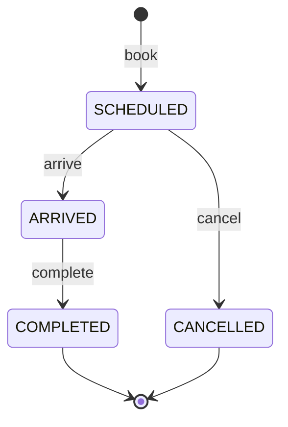

# API Reference

Base URL: `http://localhost:5000/api/v1`

- [Conventions](#conventions)
- [Authentication](#authentication) · [Users](#users) · [Departments](#departments) ·
  [Doctors & schedules](#doctors--schedules) · [Slots](#slots) · [Patients](#patients) ·
  [Appointments](#appointments)
- [Real-time events (Socket.IO)](#real-time-events-socketio)
- [Error codes](#error-codes)

## Conventions

### Response envelope

Every response, success or error, has the same shape:

```json
{
  "success": true,
  "message": "Appointment created successfully",
  "data": {},
  "meta": {}
}
```

- `data` is the resource, an array of resources, or `null`.
- `meta` holds pagination for lists and, for errors, a machine-readable `code` and optional
  `details`.

Error example (validation):

```json
{
  "success": false,
  "message": "Validation failed",
  "data": null,
  "meta": {
    "code": "BAD_REQUEST",
    "details": [
      { "field": "body.slotStart", "message": "Must be a valid time in HH:mm (24h) format" }
    ]
  }
}
```

Unexpected server errors always return a generic message with code `INTERNAL_ERROR`; stack
traces and internal messages are never sent in production.

### Authentication header

All endpoints except `/auth/login`, `/auth/refresh`, `/auth/logout` and `/health` need:

```
Authorization: Bearer <accessToken>
```

### Formats

| Value | Format | Example |
|---|---|---|
| Date | `YYYY-MM-DD`, clinic timezone (`CLINIC_TIMEZONE`) | `2026-10-19` |
| Time | `HH:mm`, 24-hour | `09:15` |
| IDs | MongoDB ObjectId (24 hex chars) | `6711f0c2a1b2c3d4e5f60789` |
| Mobile | 10–15 digits, optional leading `+` | `9876543210` |

### Pagination, sorting, filtering

List endpoints accept `page` (default 1), `limit` (default 20, max 100) and `sort`.
`sort` is a comma-separated list of allowed field names; prefix with `-` for descending
(`sort=-date,slotStart`). Unknown sort fields are ignored.

```json
"meta": { "page": 1, "limit": 20, "total": 134, "totalPages": 7 }
```

### Roles

`SA` = Super Admin, `RC` = Receptionist, `DR` = Doctor.

### Rate limits

- All `/api/v1` routes: 1000 requests per 15 minutes per IP.
- `/auth/login` and `/auth/refresh`: 20 requests per 15 minutes per IP.

Exceeding a limit returns `429` with code `RATE_LIMITED`. Standard `RateLimit-*` headers are
included.

---

## Authentication

### `POST /auth/login`

Public. Rate limited.

```json
{ "email": "reception@emr.local", "password": "Password@123" }
```

**200**: sets the `refreshToken` cookie (httpOnly, path `/api/v1/auth`, 7 days) and returns:

```json
{
  "success": true,
  "message": "Logged in successfully",
  "data": {
    "user": {
      "_id": "6711e003a1b2c3d4e5f60004",
      "name": "Riya Sharma",
      "email": "reception@emr.local",
      "role": "RECEPTIONIST",
      "isActive": true
    },
    "accessToken": "eyJhbGciOiJIUzI1NiIs..."
  },
  "meta": {}
}
```

| Status | When |
|---|---|
| 400 | Body is invalid. |
| 401 | Wrong email or password, or the account is disabled. The message is identical in every case. |
| 429 | Too many attempts. |

### `POST /auth/refresh`

Public; uses the `refreshToken` cookie. Rate limited.

Rotates the refresh token: the presented token is revoked and a new cookie is set. Returns a
new `accessToken` and `user`, in the same shape as login.

| Status | When |
|---|---|
| 401 | Cookie missing, invalid, expired or revoked. If the token was already rotated (a replay), every session from that login is revoked as well. |

> Browser clients must send requests with credentials (`withCredentials: true` /
> `credentials: 'include'`) so the cookie is included.

### `POST /auth/logout`

Public; uses the `refreshToken` cookie. Revokes the session and clears the cookie. It does not
need an access token, so a user whose access token already expired can still log out.
Idempotent: it always returns **200**.

### `GET /auth/me`

All roles. Returns the current user, with `department` populated for doctors.

---

## Users

Super Admin only.

### `POST /users`

Creates a doctor or receptionist. Super Admins cannot be created through the API.

```json
{
  "name": "Dr. Neha Rao",
  "email": "neha.rao@emr.local",
  "password": "Secret123",
  "role": "DOCTOR",
  "department": "6711e000a1b2c3d4e5f60001",
  "specialization": "Dermatologist"
}
```

- `password`: 8–72 characters, with at least one letter and one digit.
- `department` is required when `role` is `DOCTOR` and ignored for receptionists.

**201** returns the created user (never includes `passwordHash`).

| Status | When |
|---|---|
| 400 | Invalid body, role `SUPER_ADMIN`, or the department does not exist. |
| 409 | `EMAIL_TAKEN`. |

### `GET /users`

Query: `role`, `search` (name or email), `page`, `limit`,
`sort` (`name`, `email`, `role`, `createdAt`). Paginated.

---

## Departments

### `GET /departments`

All roles. Active departments sorted by name: `[{ _id, name, code }]`.

### `POST /departments`

Super Admin.

```json
{ "name": "Dermatology", "code": "DERM" }
```

**201** on success. **409** `DEPARTMENT_EXISTS` when the name or code is taken (the name check
is case-insensitive).

---

## Doctors & schedules

### `GET /doctors`

All roles. Query: `department` (id), `search` (name).

```json
{
  "success": true,
  "message": "OK",
  "data": [
    {
      "_id": "6711e001a1b2c3d4e5f60002",
      "name": "Dr. Arjun Mehta",
      "email": "arjun.mehta@emr.local",
      "specialization": "Internal Medicine",
      "department": { "_id": "6711e000a1b2c3d4e5f60001", "name": "General Medicine", "code": "GEN" }
    }
  ],
  "meta": { "total": 1 }
}
```

### `GET /doctors/:id/schedule`

Super Admin, Receptionist. Returns the schedule document, or `data: null` if none is
configured. **404** if the doctor does not exist.

### `PUT /doctors/:id/schedule`

Super Admin. Creates or replaces the doctor's weekly schedule.

```json
{
  "slotDurationMinutes": 15,
  "weeklySchedule": [
    {
      "day": "MON",
      "sessions": [
        { "label": "Morning", "start": "09:00", "end": "12:00" },
        { "label": "Evening", "start": "13:00", "end": "17:00" }
      ],
      "breaks": [{ "label": "Lunch", "start": "12:00", "end": "13:00" }]
    }
  ]
}
```

Validation rules (all return **400** with field-level details):

- `day` is one of `SUN MON TUE WED THU FRI SAT`, and each day appears at most once.
- `slotDurationMinutes` is between 5 and 240.
- Every range has `start < end`.
- Sessions must not overlap each other, and breaks must not overlap each other.
- Every session must be at least one slot long.
- Days that are not listed are non-working days.

Breaks can fall inside a session (a tea break) or between sessions (lunch). No slot is ever
generated that overlaps a break.

---

## Slots

### `GET /slots`

All roles. Doctors can only request their own grid; any other `doctorId` returns **403**.

| Query | Required | Notes |
|---|---|---|
| `date` | yes | `YYYY-MM-DD` |
| `doctorId` | one of the two | A single doctor. |
| `departmentId` | one of the two | Every active doctor in the department. |

```json
{
  "success": true,
  "message": "OK",
  "data": [
    {
      "doctor": {
        "_id": "6711e001a1b2c3d4e5f60002",
        "name": "Dr. Arjun Mehta",
        "specialization": "Internal Medicine",
        "department": { "_id": "6711e000a1b2c3d4e5f60001", "name": "General Medicine", "code": "GEN" }
      },
      "slotDurationMinutes": 15,
      "isWorkingDay": true,
      "slots": [
        { "start": "09:00", "end": "09:15", "status": "PAST" },
        {
          "start": "09:15",
          "end": "09:30",
          "status": "BOOKED",
          "appointmentId": "6711f0c2a1b2c3d4e5f60789",
          "appointmentStatus": "SCHEDULED"
        },
        { "start": "09:30", "end": "09:45", "status": "AVAILABLE" }
      ]
    }
  ],
  "meta": { "date": "2026-10-19" }
}
```

Slot `status` is one of:

- `AVAILABLE`: bookable.
- `BOOKED`: held by a non-cancelled appointment.
- `PAST`: the start time has passed in the clinic timezone.

Break periods and time outside sessions never appear. On a non-working day `slots` is empty
and `isWorkingDay` is `false`.

---

## Patients

Super Admin and Receptionist.

### `GET /patients/search?q=`

At least 2 characters. Returns up to 20 matches. How the term is read:

| Input | Matches |
|---|---|
| `PT-000042` | Exact patient code. |
| `98765` (digits) | Mobile numbers starting with these digits. |
| `anil` | Names starting with this text (case-insensitive). |

### `POST /patients`

```json
{
  "name": "Sunita Verma",
  "mobile": "9876500011",
  "email": "sunita@example.com",
  "dateOfBirth": "1990-05-21",
  "gender": "FEMALE",
  "address": "12 MG Road, Pune"
}
```

Only `name` and `mobile` are required. **201** returns the patient with a generated
`patientCode` (`PT-000043`). Mobile numbers are not unique, because family members often
share one.

### `GET /patients/:id`

Returns the full patient record. **404** if not found.

---

## Appointments

### `POST /appointments`

Super Admin, Receptionist.

Existing patient:

```json
{
  "doctorId": "6711e001a1b2c3d4e5f60002",
  "date": "2026-10-19",
  "slotStart": "09:15",
  "purpose": "Follow-up for blood pressure",
  "notes": "Bring previous reports",
  "patientId": "6711ef10a1b2c3d4e5f60111"
}
```

New patient, created in the same transaction as the appointment:

```json
{
  "doctorId": "6711e001a1b2c3d4e5f60002",
  "date": "2026-10-19",
  "slotStart": "09:15",
  "purpose": "Fever",
  "newPatient": { "name": "Anil Kumar", "mobile": "9876543210", "gender": "MALE" }
}
```

Send exactly one of `patientId` or `newPatient`. The department is taken from the doctor.

**201** returns the appointment in the same shape as `GET /appointments/:id`.

| Status | Code | When |
|---|---|---|
| 400 | `BAD_REQUEST` | Invalid body, or both or neither of `patientId`/`newPatient` given. |
| 404 | `NOT_FOUND` | Doctor or patient does not exist. |
| 409 | `SLOT_ALREADY_BOOKED` | Someone else holds the slot, including the loser of a simultaneous booking. |
| 422 | `INVALID_SLOT` | Not a working day, outside sessions, during a break, or not aligned to the slot grid (e.g. `09:07`). |
| 422 | `SLOT_IN_PAST` | Date or time is in the past. |
| 422 | `NO_SCHEDULE` | Doctor has no schedule configured. |

### `GET /appointments`

All roles. **Doctors only ever receive their own appointments**: their `doctorId` overrides any
filter the client sends.

| Query | Description |
|---|---|
| `search` | One box for patient code, mobile prefix or patient-name prefix (see Patients search). |
| `patientName` | Patient name prefix. |
| `doctorName` | Doctor name prefix. |
| `mobile` | Mobile prefix. |
| `doctorId`, `departmentId`, `patientId` | Exact match. |
| `status` | One or more, comma-separated: `SCHEDULED,ARRIVED`. |
| `dateFrom`, `dateTo` | Inclusive date range. |
| `page`, `limit` | Pagination. |
| `sort` | `date`, `slotStart`, `status`, `createdAt`, `patientName`, `doctorName`. Default `-date,slotStart`. |

Example: `GET /appointments?departmentId=...&status=SCHEDULED,ARRIVED&dateFrom=2026-10-19&dateTo=2026-10-25&sort=date,slotStart&page=1&limit=20`

```json
{
  "success": true,
  "message": "OK",
  "data": [
    {
      "_id": "6711f0c2a1b2c3d4e5f60789",
      "patient": "6711ef10a1b2c3d4e5f60111",
      "doctor": "6711e001a1b2c3d4e5f60002",
      "department": { "_id": "6711e000a1b2c3d4e5f60001", "name": "General Medicine", "code": "GEN" },
      "date": "2026-10-19",
      "slotStart": 555,
      "slotEnd": 570,
      "slotStartTime": "09:15",
      "slotEndTime": "09:30",
      "status": "SCHEDULED",
      "purpose": "Fever",
      "patientSnapshot": { "patientCode": "PT-000042", "name": "Anil Kumar", "mobile": "9876543210" },
      "doctorSnapshot": { "name": "Dr. Arjun Mehta" },
      "createdAt": "2026-10-16T05:12:40.118Z",
      "updatedAt": "2026-10-16T05:12:40.118Z"
    }
  ],
  "meta": { "page": 1, "limit": 20, "total": 1, "totalPages": 1 }
}
```

### `GET /appointments/:id`

All roles. Includes the populated `patient` (code, name, mobile, email, gender, date of
birth, address), `doctor` (name, specialization), `department`, `notes`,
`consultationNotes`, `cancellationReason` and status timestamps (`arrivedAt`, `completedAt`,
`cancelledAt`).

A doctor requesting another doctor's appointment gets **404**, so the API does not reveal that
the record exists.

### `PUT /appointments/:id`

What each role may edit:

| Role | Fields | Allowed while status is |
|---|---|---|
| Super Admin, Receptionist | `purpose`, `notes` | `SCHEDULED`, `ARRIVED` |
| Doctor (own appointments) | `consultationNotes` | `ARRIVED`, `COMPLETED` |

```json
{ "purpose": "Fever and body ache", "notes": "Wheelchair needed" }
```

| Status | Code | When |
|---|---|---|
| 400 | | Empty body. |
| 403 | `FORBIDDEN` | The role is not allowed to edit one of the sent fields. |
| 409 | `STALE_APPOINTMENT` | Someone else changed the appointment since it was read. |
| 422 | `APPOINTMENT_LOCKED` | Status does not allow edits. |

### `DELETE /appointments/:id`

Super Admin, Receptionist. **Cancels** the appointment (soft delete): the record is kept for
history and the slot becomes bookable again.

```json
{ "reason": "Patient requested reschedule" }
```

The body is optional. **422** `INVALID_STATUS_TRANSITION` if the appointment is not
`SCHEDULED`.

### `POST /appointments/:id/arrive`

Super Admin, Receptionist. `SCHEDULED` → `ARRIVED`, records `arrivedAt`.

**422** `APPOINTMENT_IN_FUTURE` if the appointment date is after today.
**422** `INVALID_STATUS_TRANSITION` for any other starting status.

### `POST /appointments/:id/complete`

Super Admin, Doctor (own appointments). `ARRIVED` → `COMPLETED`, records `completedAt`.

### Status workflow



Any other transition returns **422** `INVALID_STATUS_TRANSITION`. Every transition is applied
with a status precondition, so two staff acting at the same moment (for example one cancels
while another marks arrival) cannot both succeed: the second gets **409**
`STALE_APPOINTMENT`.

---

## Real-time events (Socket.IO)

Connect to the API origin (not `/api/v1`) and pass the access token in the handshake:

```js
import { io } from 'socket.io-client';

const socket = io('http://localhost:5000', { auth: { token: accessToken } });

// Subscribe to the grid currently on screen (doctorId and/or departmentId, plus date).
socket.emit('schedule:join', { doctorId, date: '2026-10-19' }, (ack) => console.log(ack)); // { ok, rooms }
socket.emit('schedule:leave', { doctorId, date: '2026-10-19' });

socket.on('appointment:created', refetch);
socket.on('appointment:updated', refetch);
socket.on('appointment:cancelled', refetch);
```

A connection with a missing or invalid token is rejected with
`connect_error: "Unauthorized"`. After the access token is refreshed, reconnect with the new
token.

**Event payload.** It deliberately contains no patient data; clients refetch through the REST
API, which applies the usual permission checks.

```json
{
  "appointmentId": "6711f0c2a1b2c3d4e5f60789",
  "doctorId": "6711e001a1b2c3d4e5f60002",
  "departmentId": "6711e000a1b2c3d4e5f60001",
  "date": "2026-10-19",
  "slotStart": "09:15",
  "status": "CANCELLED"
}
```

**Who receives each event:**

| Room | Joined by | Receives |
|---|---|---|
| `doctor:{doctorId}:{date}` | `schedule:join` with `doctorId` | Changes to that doctor's day. |
| `department:{departmentId}:{date}` | `schedule:join` with `departmentId` | Changes to any doctor in that department that day. |
| `appointments:staff` | Every Super Admin and Receptionist, automatically | All changes (for list screens). |
| `appointments:doctor:{doctorId}` | Every doctor, automatically | Changes to their own appointments. |

Doctors can only join rooms for their own `doctorId`; other requests are acknowledged with
`ok: false`.

---

## Health

### `GET /health`

Public. Returns `{ uptime, database: "up" | "down" }`. Used by the Docker health check.

---

## Error codes

| HTTP | `meta.code` | Meaning |
|---|---|---|
| 400 | `BAD_REQUEST` | Validation failed; see `meta.details`. Also malformed JSON or an invalid id. |
| 401 | `UNAUTHORIZED` | Missing, invalid or expired token, or bad credentials. |
| 403 | `FORBIDDEN` | Authenticated, but the role is not allowed. |
| 404 | `NOT_FOUND` | Resource missing, or not visible to the caller. |
| 404 | `ROUTE_NOT_FOUND` | Unknown endpoint. |
| 409 | `SLOT_ALREADY_BOOKED` | Slot already taken. |
| 409 | `STALE_APPOINTMENT` | Concurrent modification; refresh and retry. |
| 409 | `EMAIL_TAKEN` / `DEPARTMENT_EXISTS` / `DUPLICATE` | Unique value already in use. |
| 413 | `PAYLOAD_TOO_LARGE` | Body over 100 KB. |
| 422 | `INVALID_SLOT` / `SLOT_IN_PAST` / `NO_SCHEDULE` / `DOCTOR_NO_DEPARTMENT` | Booking rule violated. |
| 422 | `INVALID_STATUS_TRANSITION` / `APPOINTMENT_LOCKED` / `APPOINTMENT_IN_FUTURE` | Workflow rule violated. |
| 429 | `RATE_LIMITED` | Too many requests. |
| 500 | `INTERNAL_ERROR` | Unexpected error (details are logged, not returned). |
