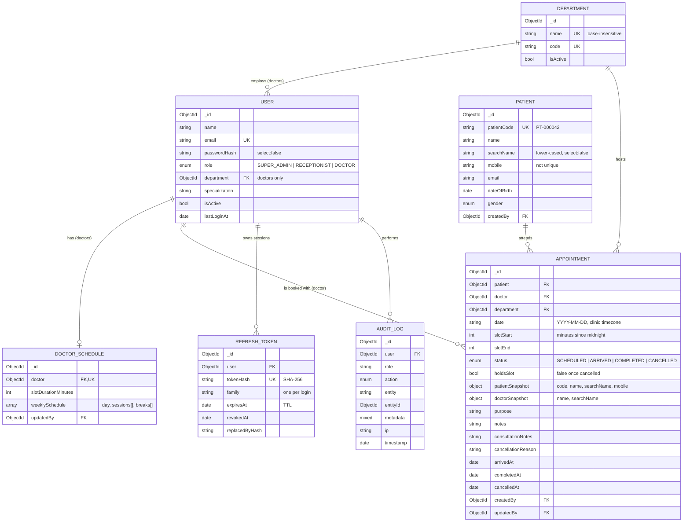

# Database Design

MongoDB, accessed through Mongoose. Seven application collections plus one helper (`counters`).

## Entity relationship diagram



## Collections

| Collection | Purpose | Lifecycle |
|---|---|---|
| `users` | Staff accounts of all three roles. Doctors carry `department` and `specialization`. | Created by Super Admin (or the seed script for the first admin). Deactivated with `isActive: false`, never deleted, because appointments and audit logs reference them. |
| `departments` | Clinical departments (General Medicine, Cardiology, ...). | Long-lived reference data. |
| `doctorschedules` | One weekly template per doctor: working days, sessions, breaks, slot length. | Upserted by Super Admin. Editing it changes future slot generation immediately. |
| `patients` | Patient master record. | Created at the front desk, either on its own or inline while booking. |
| `appointments` | One document per booking. | Never deleted. Cancelling sets `status: CANCELLED` and `holdsSlot: false`. |
| `refreshtokens` | Server-side record of each issued refresh token (hash only). | Removed automatically by a TTL index when `expiresAt` passes. |
| `auditlogs` | Append-only trail of logins and appointment/user/schedule changes. | Append-only. A retention policy (TTL or archiving) belongs to operations; see *Future improvements* in the README. |
| `counters` | Atomic sequences, used to generate `patientCode`. | One document per sequence (`_id: "patient"`). |

## Relationships and why they are modelled this way

**References, not embedding, for the core entities.** Patients, doctors and appointments all
grow independently and are queried independently (a patient's history, a doctor's day, the
global list). Embedding appointments inside patients or doctors would create unbounded
arrays, so appointments are their own collection and reference the others by `ObjectId`.

**Selective denormalisation on `appointments`.** The appointment list is the hottest read
path, and it needs to search and show the patient's name, mobile and code and the doctor's
name. Rather than doing a `$lookup` (a join) on every list request, the appointment stores a
small snapshot:

- `patientSnapshot: { patientCode, name, searchName, mobile }`
- `doctorSnapshot: { name, searchName }`

The snapshot is written once, at booking time. Trade-off: if a patient's name is later
corrected, existing appointments keep the old name until a background job back-fills them
(listed under *Known limitations*). In exchange, search and listing run against a single
collection with a single index each.

`department` is copied from the doctor at booking time as a real reference, so
"appointments by department" is an indexed equality match and stays historically correct even
if a doctor later moves department.

**Schedule as a template, slots computed.** Slots are not stored. A doctor with 15-minute
slots, 7 hours a day and 5 days a week would need ~7,000 slot documents a year, and all of
them would have to be rewritten whenever the schedule changed. Instead the template is stored
once and slots are generated in memory per request (see `services/slotGenerator.js`). The
only persisted record of a slot being taken is the appointment itself.

**Time representation.** `date` is a `YYYY-MM-DD` string in the clinic timezone, and
`slotStart`/`slotEnd` are minutes since midnight. This avoids timezone drift (a 09:00 slot is
09:00 regardless of server timezone), string dates sort correctly for range queries, and slot
arithmetic is plain integer maths.

## Indexes

| Collection | Index | Type | Serves |
|---|---|---|---|
| appointments | `{ doctor: 1, date: 1, slotStart: 1 }` where `holdsSlot: true` | **unique, partial** | **Double-booking guard.** See below. |
| appointments | `{ doctor: 1, date: 1 }` | | Slot grid for a doctor/day; a doctor's own list. |
| appointments | `{ date: -1, slotStart: 1 }` | | Default list sort and date-range filter. |
| appointments | `{ status: 1, date: -1 }` | | Status filter plus date sort. |
| appointments | `{ department: 1, date: -1 }` | | Department filter plus date sort. |
| appointments | `{ patient: 1, date: -1 }` | | A patient's appointment history. |
| appointments | `{ 'patientSnapshot.mobile': 1 }` | | Mobile search (anchored prefix). |
| appointments | `{ 'patientSnapshot.searchName': 1 }` | | Patient name search (anchored prefix). |
| appointments | `{ 'patientSnapshot.patientCode': 1 }` | | Patient-code search (exact). |
| appointments | `{ 'doctorSnapshot.searchName': 1 }` | | Doctor name search (anchored prefix). |
| users | `{ email: 1 }` | unique | Login lookup; prevents duplicate accounts. |
| users | `{ role: 1, department: 1, isActive: 1 }` | | `GET /doctors?department=` |
| departments | `{ code: 1 }` | unique | |
| departments | `{ name: 1 }` | unique, case-insensitive collation | Prevents "Cardiology" and "cardiology" both existing. |
| doctorschedules | `{ doctor: 1 }` | unique | One schedule per doctor; lookup by doctor. |
| patients | `{ patientCode: 1 }` | unique | Lookup by code. |
| patients | `{ mobile: 1 }` | | Mobile search (anchored prefix). |
| patients | `{ searchName: 1 }` | | Name search (anchored prefix). |
| refreshtokens | `{ tokenHash: 1 }` | unique | Lookup during refresh/logout. |
| refreshtokens | `{ family: 1 }` | | Revoking a whole session family on token reuse. |
| refreshtokens | `{ user: 1 }` | | Revoking all sessions of a user. |
| refreshtokens | `{ expiresAt: 1 }` | TTL (`expireAfterSeconds: 0`) | Automatic cleanup of expired tokens. |
| auditlogs | `{ timestamp: -1 }` | | Recent activity. |
| auditlogs | `{ entity: 1, entityId: 1, timestamp: -1 }` | | History of one record. |
| auditlogs | `{ user: 1, timestamp: -1 }` | | Activity of one user. |

### The double-booking index

```js
{ doctor: 1, date: 1, slotStart: 1 }, { unique: true, partialFilterExpression: { holdsSlot: true } }
```

- **Unique** means MongoDB itself refuses a second document with the same doctor, date and
  slot start. Two simultaneous requests cannot both succeed, however many API instances are
  running, because the check and the write are a single atomic operation inside the database.
- **Partial on `holdsSlot: true`** means cancelled appointments (`holdsSlot: false`) are not
  in the index, so a cancelled slot can be booked again while the cancelled record is kept
  for history.
- A dedicated boolean is used instead of `status: { $ne: 'CANCELLED' }` because partial
  index filters support only a limited set of operators, and `$ne`/`$nin` are not among them.
  A plain equality on a boolean also works on every MongoDB version and makes the intent
  obvious.

## Query optimisation strategy

1. **Every filter has an index.** The list endpoint accepts only filters that map to an index
   above. Sorting is restricted to an allow-list (`date`, `slotStart`, `status`, `createdAt`,
   `patientName`, `doctorName`), so clients cannot ask for a sort on an unindexed field.
2. **Prefix search, not substring search.** Name and mobile search use anchored,
   case-normalised regexes (`/^ram/` on the lower-cased `searchName`). An anchored regex can
   walk a B-tree index; `/ram/i` would scan the whole collection.
3. **The search term picks the index.** One search box serves three indexes:
   `PT-000123` → `patientCode` (exact), digits → `mobile` (prefix), anything else →
   `searchName` (prefix).
4. **Projection.** List queries `select()` only the fields the table shows; detail-only fields
   (notes, consultation notes, timestamps of state changes) are fetched only by `GET /:id`.
5. **`lean()` reads.** Query results skip Mongoose document hydration, roughly halving
   CPU and memory per read.
6. **Count and page in parallel.** `find()` and `countDocuments()` run concurrently with
   `Promise.all`.
7. **Constant query count for the slot grid.** `GET /slots?departmentId=` returns every doctor
   in a department using exactly two queries (all schedules with `$in`, then all of that
   day's appointments with `$in`), not 2 × number of doctors.
8. **Stable pagination.** `_id` is appended to every sort as a tie-breaker so pages never
   repeat or skip rows when sort values are equal.
9. **Indexes are built deliberately in production.** `autoIndex` is off in production;
   `npm run db:indexes` syncs them as a deploy step, so a large index build never blocks app
   start-up.

## Sample documents

### `appointments`

```json
{
  "_id": "6711f0c2a1b2c3d4e5f60789",
  "patient": "6711ef10a1b2c3d4e5f60111",
  "doctor": "6711e001a1b2c3d4e5f60002",
  "department": "6711e000a1b2c3d4e5f60001",
  "date": "2026-10-19",
  "slotStart": 555,
  "slotEnd": 570,
  "status": "SCHEDULED",
  "holdsSlot": true,
  "purpose": "Fever and cough for 3 days",
  "notes": "Prefers Hindi",
  "patientSnapshot": {
    "patientCode": "PT-000042",
    "name": "Anil Kumar",
    "searchName": "anil kumar",
    "mobile": "9876543210"
  },
  "doctorSnapshot": { "name": "Dr. Arjun Mehta", "searchName": "dr. arjun mehta" },
  "createdBy": "6711e003a1b2c3d4e5f60004",
  "createdAt": "2026-10-16T05:12:40.118Z",
  "updatedAt": "2026-10-16T05:12:40.118Z"
}
```

`slotStart: 555` is 09:15 (9 × 60 + 15). The API also returns `slotStartTime: "09:15"`.

### `doctorschedules`

```json
{
  "_id": "6711e101a1b2c3d4e5f60101",
  "doctor": "6711e001a1b2c3d4e5f60002",
  "slotDurationMinutes": 15,
  "weeklySchedule": [
    {
      "day": "MON",
      "sessions": [
        { "label": "Morning", "start": "09:00", "end": "12:00" },
        { "label": "Evening", "start": "13:00", "end": "17:00" }
      ],
      "breaks": [{ "label": "Tea break", "start": "10:30", "end": "10:45" }]
    }
  ],
  "updatedBy": "6711e000a1b2c3d4e5f60000"
}
```

Monday then has 27 bookable slots: 09:00–10:15 and 10:45–11:45 in the morning (the 10:30 slot
falls in the break), and 13:00–16:45 in the evening.

### `patients`

```json
{
  "_id": "6711ef10a1b2c3d4e5f60111",
  "patientCode": "PT-000042",
  "name": "Anil Kumar",
  "searchName": "anil kumar",
  "mobile": "9876543210",
  "gender": "MALE",
  "dateOfBirth": "1984-03-12T00:00:00.000Z",
  "createdBy": "6711e003a1b2c3d4e5f60004"
}
```

### `users` (doctor)

```json
{
  "_id": "6711e001a1b2c3d4e5f60002",
  "name": "Dr. Arjun Mehta",
  "email": "arjun.mehta@emr.local",
  "passwordHash": "$2b$12$...",
  "role": "DOCTOR",
  "department": "6711e000a1b2c3d4e5f60001",
  "specialization": "Internal Medicine",
  "isActive": true,
  "lastLoginAt": "2026-10-16T04:58:01.000Z"
}
```

`passwordHash` has `select: false` and is also stripped by the `toJSON` transform, so it never
leaves the server.

### `refreshtokens`

```json
{
  "user": "6711e001a1b2c3d4e5f60002",
  "tokenHash": "9f2c1e...e7a1",
  "family": "0b6a3f8e-4c1d-4d7e-9b0a-2f6c3e1d9a77",
  "expiresAt": "2026-10-23T04:58:01.000Z",
  "revokedAt": "2026-10-16T05:13:01.000Z",
  "replacedByHash": "41aa07...0c3d"
}
```

### `auditlogs`

```json
{
  "user": "6711e003a1b2c3d4e5f60004",
  "role": "RECEPTIONIST",
  "action": "APPOINTMENT_CANCELLED",
  "entity": "Appointment",
  "entityId": "6711f0c2a1b2c3d4e5f60789",
  "metadata": { "from": "SCHEDULED", "to": "CANCELLED" },
  "ip": "10.0.4.17",
  "timestamp": "2026-10-16T06:40:11.512Z"
}
```

Audit actions: `LOGIN`, `LOGIN_FAILED`, `LOGOUT`, `TOKEN_REUSE_DETECTED`, `USER_CREATED`,
`SCHEDULE_UPDATED`, `PATIENT_CREATED`, `APPOINTMENT_CREATED`, `APPOINTMENT_UPDATED`,
`APPOINTMENT_ARRIVED`, `APPOINTMENT_COMPLETED`, `APPOINTMENT_CANCELLED`.
